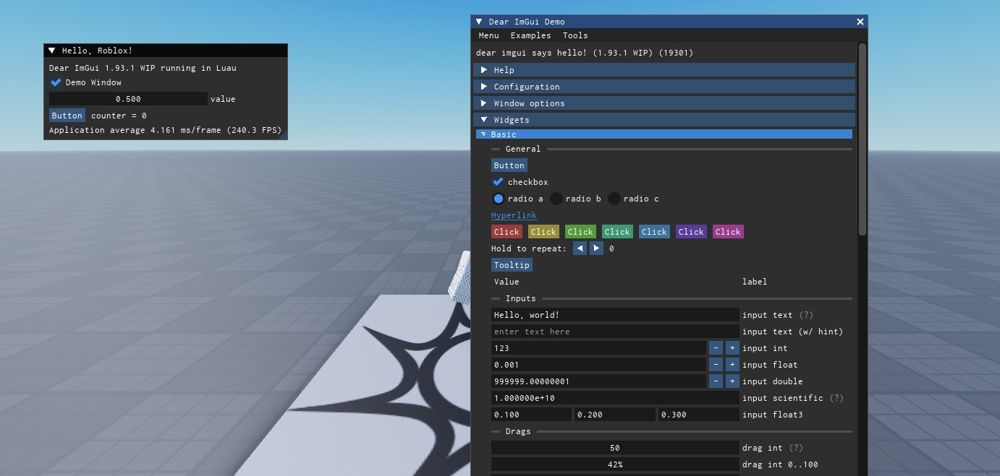
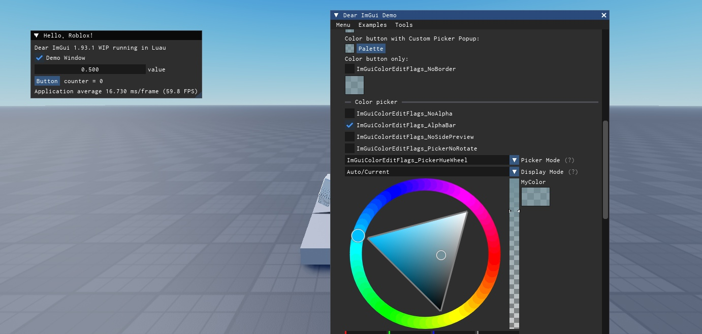

# Dear Luau GUI

A faithful port of [Dear ImGui](https://github.com/ocornut/imgui) (master, 1.93.1 WIP) to Luau for Roblox.

The full library is here: windows, every widget, tables, menus, popups, tabs, tree nodes, drag and drop, multi-select, keyboard/gamepad navigation, the complete `ShowDemoWindow()`, the Style Editor and the Metrics/Debugger tools. Behaviour was checked frame by frame against the upstream C++ build fed with identical input.





## Install

**Model file (easiest)**

1. Download `ImGui.rbxm` from the [latest release](https://github.com/dowoge/dear-luaugui/releases/latest).
2. Drag it into Studio and put it in `ReplicatedStorage`.
3. Optionally download `ImGuiDemo.rbxm` (a LocalScript) and put it in `StarterPlayer > StarterPlayerScripts` to see the demo window.

**From source**

Copy `ReplicatedStorage/ImGui` into your project with Rojo, Studio's file sync, or any other sync tool. `tools/build.sh` rebuilds the `.rbxm` files with Rojo.

## Quick start

In a LocalScript:

```lua
local ReplicatedStorage = game:GetService("ReplicatedStorage")
local ImGui = require(ReplicatedStorage.ImGui)

local counter = 0
local speed = 0.5
local enabled = true

ImGui.ImplRoblox.Start(function()
	ImGui.Begin("My Tool")
	ImGui.Text("Hello from Dear ImGui!")
	if ImGui.Button("Click me") then
		counter += 1
	end
	ImGui.SameLine()
	ImGui.Text("clicked %d times", counter)

	local _
	_, enabled = ImGui.Checkbox("Enabled", enabled)
	_, speed = ImGui.SliderFloat("Speed", speed, 0, 1)
	ImGui.End()

	ImGui.ShowDemoWindow()
end)
```

`ImplRoblox.Start(fn, options)` creates the context, sets up input and rendering, and calls `fn` every frame between `NewFrame()` and `Render()`. It returns a function that stops everything. If `fn` errors, the error is printed with a traceback and the UI keeps running (it uses Dear ImGui's own error-recovery API).

Options: `Parent` (defaults to `PlayerGui`), `DisplayOrder` (default 1000), `Name`, `RenderStepName`, `RenderPriority`.

If you want to drive the frame yourself:

```lua
ImGui.CreateContext()
ImGui.ImplRoblox.Init()
RunService:BindToRenderStep("MyGui", Enum.RenderPriority.Last.Value, function(dt)
	ImGui.ImplRoblox.NewFrame(dt)
	ImGui.NewFrame()
	-- your UI
	ImGui.Render()
	ImGui.ImplRoblox.RenderDrawData(ImGui.GetDrawData())
end)
```

## How the C++ API maps to Luau

The function names, arguments and defaults are the same as in `imgui.h`, so the upstream documentation, FAQ and demo source apply directly. The differences come from Luau not having pointers:

**Values passed by pointer are returned.** Anything C++ takes as `bool*`, `int*`, `float*`, etc. is passed by value and returned after the normal return value:

```lua
local changed
changed, value = ImGui.SliderFloat("Value", value, 0, 1)   -- bool SliderFloat(label, float* v, ...)
local open
visible, open = ImGui.Begin("Window", open)               -- bool Begin(name, bool* p_open, ...)
showDemo = ImGui.ShowDemoWindow(showDemo)                 -- void ShowDemoWindow(bool* p_open)
local pressed, selected = ImGui.Selectable("Item", selected)
```

**Arrays are tables, changed in place.** `float v[3]`, `float col[4]`, etc. take a Luau array and only return the "changed" flag:

```lua
local color = { 1, 0.5, 0.2, 1 }
ImGui.ColorEdit4("Color", color)
local pos = { 0, 0, 0 }
ImGui.DragFloat3("Position", pos)
```

**Strings.** `InputText` works like `imgui_stdlib` (no buffer size): `changed, text = ImGui.InputText("Name", text, flags)`. Format strings use C printf syntax: `ImGui.Text("%d items, %.2f%%", n, pct)`.

**Enums.** `ImGuiWindowFlags_NoTitleBar` becomes `ImGui.WindowFlags.NoTitleBar` (also available as `ImGui.ImGuiWindowFlags.NoTitleBar`). Combine flags with `bit32.bor`. Indices keep their C++ meaning (0-based), so `style.Colors[ImGui.Col.Text + 1]` is the text color.

**Math types.** `ImVec2` is a native `vector` (`ImGui.ImVec2(x, y)`, fields `.x`/`.y`, supports `+ - * /`). `ImVec4` is `ImGui.ImVec4(x, y, z, w)`. Both are read-only values. Packed colors use `ImGui.IM_COL32(r, g, b, a)`.

**Images.** Pass any Roblox image id as the texture: `ImGui.Image("rbxassetid://123", ImGui.ImVec2(64, 64))`. To use `uv0`/`uv1`, pass `{ Image = "rbxassetid://123", Size = Vector2.new(w, h) }` so the pixel size is known.

**Custom drawing.** `ImGui.GetWindowDrawList()` returns an `ImDrawList`; call its methods with `:` (`draw_list:AddLine(p1, p2, col, thickness)`).

## Roblox-specific behaviour

- **Rendering** uses pooled Frames, TextLabels and ImageLabels inside a ScreenGui. Properties are only written when they change, so a static UI costs almost nothing to render.
- **Font:** `Enum.Font.Code`, which has exactly the metrics of Dear ImGui's default ProggyClean font (7 px advance at 13 px), so layouts match upstream. Text looks slightly different from the bitmap font.
- **EditableImage:** small filled shapes, thick curved lines and the color-wheel triangle are anti-aliased with EditableImage when the experience allows it (Game Settings > Security), and fall back to Frame-based drawing otherwise.
- **Hidden cursor on drag:** while dragging a `Drag*` widget the cursor is hidden and locked in place (`MouseBehavior.LockCurrentPosition`), the value follows raw mouse movement without limits, and the cursor reappears where it was on release. This isn't upstream behaviour; turn it off with `ImGui.GetIO().ConfigDragHideCursor = false`.
- **Text input** goes through a hidden TextBox, so keyboard layouts, IME and OS clipboard copy/paste work.
- **Mouse cursors:** Dear ImGui's cursor requests (resize arrows, text beam, hand) are mapped to `rbxasset://SystemCursors/*` icons.
- **Input blocking:** every visible window has an `Active` frame behind it so clicks on it count as GUI input, and while `io.WantCaptureMouse` is set the mouse buttons and wheel are sunk through ContextActionService.
- **No filesystem:** `io.IniFilename` is `nil`, so window positions aren't saved between sessions. `ImGui.SaveIniSettingsToMemory()` / `LoadIniSettingsFromMemory()` work if you want to store them yourself (e.g. in a DataStore).

## Known differences from upstream

- Luau numbers are doubles, so behaviour that depends on 32-bit float rounding can differ at the extremes.
- Pointer-based IDs (`PushID(table)`) work but produce different hash values than C++.
- Thick polylines that aren't anti-aliased with EditableImage have no mitered joints.
- The Fonts and Images demo sections have no texture atlas to show.
- Multi-viewport and docking are not included (they aren't in upstream master either).

## Tests

`tools/` runs the library headless in plain [Luau](https://github.com/luau-lang/luau) (no Roblox needed):

```sh
cd tools
luau run.luau -a openall 30        # every demo section and example app open
luau run.luau -a fuzzall 600 1     # random mouse/keyboard input
./all.sh                           # full stress suite
./crawl.sh                         # clicks, drags, types into every item of every demo window
```

## Credits

Dear ImGui is by Omar Cornut and contributors: https://github.com/ocornut/imgui. Both the original and this port are MIT licensed (see `LICENSE`).
